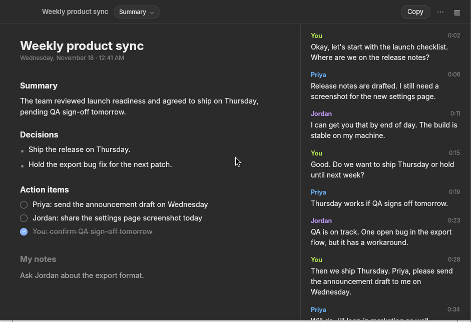
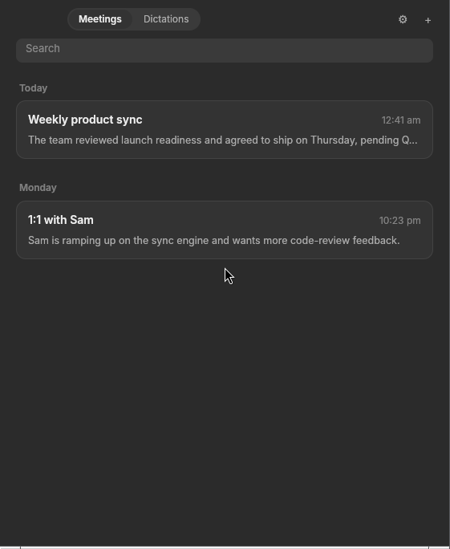
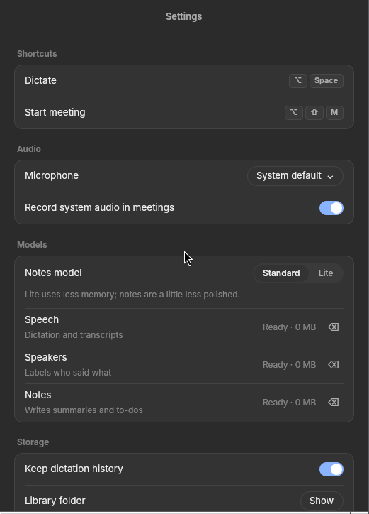

# Zwisper

A small, calm, local-first dictation and meeting-notes app for macOS.

- **Dictate anywhere.** Press <kbd>⌥ Space</kbd>, speak, and the text is pasted where you're typing. Hold the key to talk instead.
- **Record meetings.** A quiet window with the live transcript on the right and your own notes on the left.
- **Know who said what.** Remote voices are separated into speakers. Rename them and the change applies everywhere.
- **Notes in one click.** Summary, Action items, To-do list, 1:1, or Follow-up email, written by a local model that treats your own notes as facts.
- **Nothing leaves your Mac.** Models download once; audio is never uploaded.



| Dictation | Library | Settings |
|---|---|---|
|  |  |  |

_The screenshots come from `--demo` mode rendered on Linux (hence the window-manager title bars). On macOS the dictation pill is a borderless floating panel._

## Models

The app ships with no models. Each pack downloads the first time it's needed and is checked against a SHA-256 hash.

| Pack | Standard | Lite | Runtime |
|---|---|---|---|
| Speech | NVIDIA Parakeet TDT 0.6B v2 (English), int8, 660 MB | same | sherpa-onnx |
| Speakers | pyannote segmentation-3.0 + WeSpeaker ResNet34, 32 MB | same | sherpa-onnx |
| Notes | Qwen3-4B-Instruct-2507 Q4_K_M, 2.5 GB | Qwen3-1.7B Q4_K_M, 1.1 GB | llama.cpp (Metal) |

Macs with 16 GB of memory or more get Standard; smaller Macs get Lite. Settings has one switch to change it. The model list is fixed in [`manifest.rs`](crates/adapters/models-http/src/manifest.rs).

## Architecture

Ports and adapters. Every engine, OS service and storage mechanism sits behind a trait in `zwisper-core`. Concrete strategies live in `crates/adapters/*` and are picked in exactly one place, the composition root in `crates/app`. The UI only sends `Command`s and renders `Event`s. Engines are hot-swappable at runtime. A test enforces the dependency rule.

```
crates/
├── core/              domain, ports, services, command/event bus, decorators, contract tests
├── ui/                GPUI views (depends on core only)
├── app/               composition root: demo (any OS) and macOS
└── adapters/
    ├── sherpa/        Parakeet transcriber, Silero VAD, speaker diarizer
    ├── llama/         Qwen note writer
    ├── templates/     the five note templates + output validators
    ├── store-fs/      session folders, WAV tracks, dictation log, settings
    ├── models-http/   curated manifest, resumable downloads, SHA-256
    ├── audio-macos/   cpal microphone, Core Audio process tap
    ├── platform-macos/ hotkeys, paste/typing injection, permissions, login item, window helpers
    └── fakes/         test doubles for every port
```

The full design is in [docs/ARCHITECTURE.md](docs/ARCHITECTURE.md). Current status and next steps: [docs/HANDOFF.md](docs/HANDOFF.md).

## Build and run (macOS 14.4+, Apple Silicon)

Install Rust (`rustup`) and Xcode Command Line Tools first.

```bash
cargo run --release -p zwisper
```

To build the app (ad-hoc signed, for local use):

```bash
./scripts/bundle-macos.sh
```

This writes `target/release/bundle/Zwisper.app` and `Zwisper.dmg`, then opens the DMG so you can drag Zwisper into Applications. Set `NO_OPEN=1` to skip opening it.

macOS ties permissions to the app's signature, so run the bundled `.app` when testing microphone, Accessibility and system-audio access. A plain `cargo run` binary may be asked again after each rebuild.

### Demo mode (any OS)

This mode uses scripted engines, fake audio and seeded data. It's handy for UI work:

```bash
cargo run -p zwisper -- --demo --open meeting
```

`--open` also accepts `library`, `settings`, `onboarding`, `live` and `pill`. Set `ZWISPER_THEME=dark` or `ZWISPER_THEME=light` to force a theme.

## Tests

```bash
cargo test -p zwisper-core -p zwisper-templates -p zwisper-store-fs -p zwisper-models-http
```

The real-model tests download the models first, so they're opt-in:

```bash
cargo test -p zwisper-sherpa -p zwisper-llama -- --ignored
```

## Status

This is an MVP.

**Verified:**
- The core and all its services pass end to end on fakes.
- Storage, templates and the model downloader are tested.
- The UI renders in demo mode.

**Written but not yet run on a Mac:** the macOS adapters, which are type-checked only, and the full macOS build. See the `VERIFY ON MAC` comments in `crates/adapters/*-macos`.

**Known gaps:**
- Audio is stored as WAV (FLAC is planned).
- There's no shortcut editor; shortcuts can be changed in `config.toml`.
- There's no audio playback.
- Esc-to-cancel works only via the pill's Cancel button.

## Credits

The model credits are shown in Settings → About and listed in `manifest.rs`. Parakeet is CC-BY-4.0 © NVIDIA.
