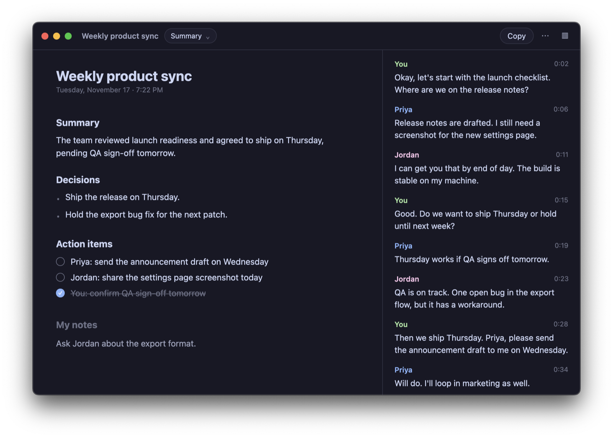
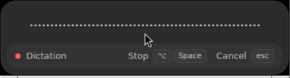
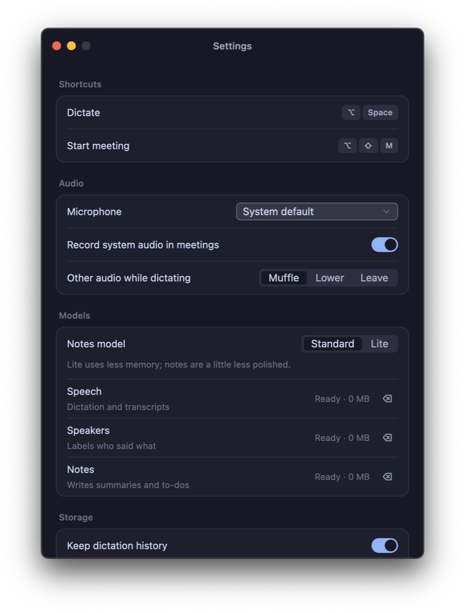
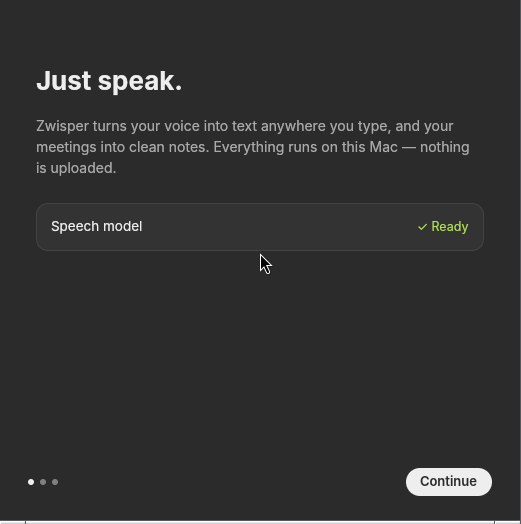
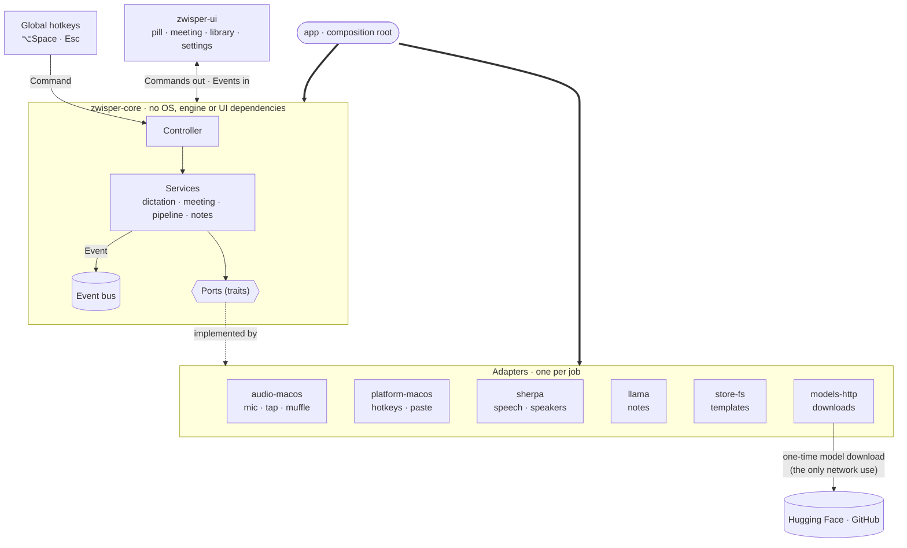

<div align="center">

# Zwisper

**Calm, local-only dictation and meeting notes for macOS.**
Press a key, speak, and your words appear wherever you're typing. Record a meeting and get clean notes. Nothing leaves your Mac.

<picture>
  <source media="(prefers-color-scheme: dark)" srcset="docs/screenshots/meeting-dark.png">
  <source media="(prefers-color-scheme: light)" srcset="docs/screenshots/meeting-light.png">
  
</picture>

</div>

## What it does

### Dictate anywhere

<p align="center"></p>

- Press <kbd>⌥</kbd> <kbd>Space</kbd>, speak, press it again. The text is pasted into whatever app you're typing in. Hold the key instead for push-to-talk.
- <kbd>Esc</kbd> cancels. It's only claimed while you're dictating, so other apps keep their Esc.
- **Other audio is muffled while you talk**, like a neighbour's TV through the wall: you can tell something's playing, but can't follow the words. You can switch it to plain volume lowering, or turn it off.
- If macOS won't let Zwisper paste, the text goes to the clipboard and into your history instead, so nothing you said is lost.

### Meetings

- A quiet window with your own notes on the left and a live transcript on the right.
- Your microphone and the call's audio are recorded as separate tracks, so your own voice is always "You". The other voices are separated into speakers you can rename.
- When the meeting ends, one click writes notes from a fixed set of templates: **Summary**, **Action items**, **To-do list**, **1:1** and **Follow-up email**. Your own notes are treated as facts.

### Local only, for good

Every model runs on your Mac. Models download once and are checked against SHA-256 hashes. That download is the only time Zwisper uses the network, and audio, transcripts and notes are never uploaded. There's no account, no cloud and no API keys. There will never be a cloud version.

## Screenshots

| Library | Settings | First run |
|:---:|:---:|:---:|
|  | <picture><source media="(prefers-color-scheme: light)" srcset="docs/screenshots/settings-light.png"></picture> |  |

Zwisper has two themes, both [Catppuccin](https://catppuccin.com): **Mocha** (dark) and **Latte** (light). There are no other themes and no theme picker. Zwisper uses Latte if macOS is in light mode when it starts, and Mocha otherwise.

## Models

The app ships with no models. Each pack downloads the first time it's needed.

| Pack | Standard | Lite | Runtime |
|---|---|---|---|
| Speech | NVIDIA Parakeet TDT 0.6B v2 (English), int8, 660 MB | same | sherpa-onnx |
| Speakers | pyannote segmentation-3.0 + WeSpeaker ResNet34, 32 MB | same | sherpa-onnx |
| Notes | Qwen3-4B-Instruct-2507 Q4_K_M, 2.5 GB | Qwen3-1.7B Q4_K_M, 1.1 GB | llama.cpp (Metal) |

Macs with 16 GB of memory or more get Standard; smaller Macs get Lite. That's the only model choice, and you can change it in Settings. The list is fixed in [`manifest.rs`](crates/adapters/models-http/src/manifest.rs).

## Install from source

You need macOS 14.4 or later on Apple Silicon, [Rust](https://rustup.rs), and the Xcode Command Line Tools. Full Xcode is optional.

```bash
cargo app
```

`cargo app` builds a release version, packages `Zwisper.app` into `target/release/bundle/Zwisper.dmg`, and opens the disk image so you can drag Zwisper into Applications.

### Permissions

macOS asks for these the first time they're needed. The onboarding screen walks you through them.

| Permission | Why |
|---|---|
| Microphone | To hear you |
| Accessibility | To paste text where you're typing |
| System audio | To transcribe the other side of calls, and to muffle other audio while you dictate |

Local builds are signed with a self-signed "Zwisper Local Dev" certificate. [`scripts/dev-signing-identity.sh`](scripts/dev-signing-identity.sh) creates it on first use, in its own keychain at `~/Library/Keychains/zwisper-dev.keychain-db`. Because the signature stays the same between builds, permissions you grant survive rebuilds. Delete that keychain file to start over.

## Development

### Demo mode

Demo mode runs the full UI with scripted engines, fake audio and sample meetings. It needs no models and no permissions:

```bash
cargo run -p zwisper -- --demo --open meeting
```

`--open` also accepts `library`, `settings`, `onboarding`, `live` and `pill`. Set `ZWISPER_THEME=dark` (Mocha) or `ZWISPER_THEME=light` (Latte) to force one.

### Tests

These are fast and need no models or OS access:

```bash
cargo test -p zwisper-core -p zwisper-templates -p zwisper-store-fs -p zwisper-ui -p zwisper-audio-macos
```

These download the real models first, about 4 GB:

```bash
cargo test -p zwisper-sherpa -p zwisper-llama -- --ignored
```

### Handy tools

- **Logs:** written to `~/Library/Logs/Zwisper/zwisper.log`, and they also show up in Console.app.
- **Previewing the muffle effect:** run a WAV file through the dictation muffle without opening the app. The file must be 32-bit float; `afconvert -f WAVE -d LEF32@48000` converts one.

  ```bash
  cargo run -p zwisper-audio-macos --example muffle_preview -- in.wav out.wav
  ```

## Architecture

Zwisper uses ports and adapters:
- Every engine, OS service and storage mechanism sits behind a trait in `zwisper-core`.
- Concrete implementations live in `crates/adapters/*`, and are chosen in exactly one place, the composition root in `crates/app`.
- The UI only sends `Command`s and renders `Event`s.
- Engines can be swapped at runtime.

A test enforces this dependency rule.



Solid arrows are runtime data flow, dotted arrows are "implemented by", and thick arrows are where the app wires things together.

```
crates/
├── core/               domain, ports, services, command/event bus, decorators, contract tests
├── ui/                 GPUI views (depends on core only), Catppuccin theme
├── app/                composition root: demo (any OS) and macOS
└── adapters/
    ├── sherpa/         Parakeet transcriber, Silero VAD, speaker diarizer
    ├── llama/          Qwen note writer
    ├── templates/      the five note templates + output validators
    ├── store-fs/       session folders, WAV tracks, dictation log, settings
    ├── models-http/    curated manifest, resumable downloads, SHA-256
    ├── audio-macos/    microphone, Core Audio process tap, muffle/ducking
    ├── platform-macos/ hotkeys, paste/typing injection, permissions, login item, window helpers
    └── fakes/          test doubles for every port
xtask/                  `cargo app`
```

The UI is built with [GPUI](https://github.com/zed-industries/zed/tree/main/crates/gpui), Zed's GPU-accelerated UI framework, through [GPUI Kit](https://gpui-kit.com). Settings uses GPUI Kit's components. The dictation pill and the other windows are custom views styled to match.

The full design is in [docs/ARCHITECTURE.md](docs/ARCHITECTURE.md). Current status and next steps are in [docs/HANDOFF.md](docs/HANDOFF.md).

## Status

Zwisper is an early MVP in active development.

**Known gaps:**
- Audio is stored as WAV; FLAC is planned.
- Shortcuts can only be changed in `config.toml`. There's no shortcut editor yet.
- Meetings have no audio playback.

Items still to check on real hardware are marked `VERIFY ON MAC` in the code and listed in [HANDOFF.md](docs/HANDOFF.md).

## Credits

- **Models:** credits are shown in Settings → About and listed in [`manifest.rs`](crates/adapters/models-http/src/manifest.rs). Parakeet is CC-BY-4.0 © NVIDIA.
- **UI:** [GPUI](https://github.com/zed-industries/zed) by Zed Industries; [GPUI Kit](https://github.com/longbridge/gpui-kit) by Longbridge (Apache-2.0); the [Catppuccin](https://github.com/catppuccin/catppuccin) palette (MIT).

Zwisper is MIT-licensed.
